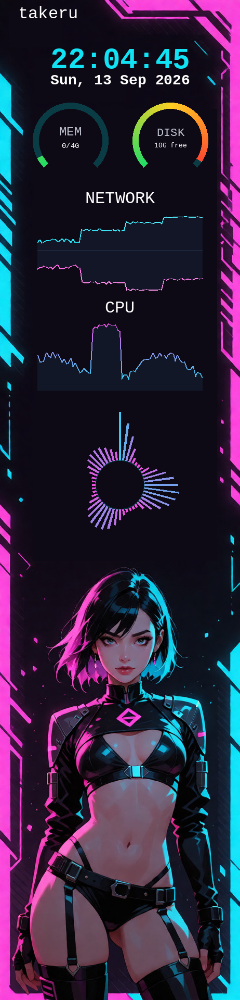

# akp02d

A themed stats display for the Ajazz AKP02 panel, built on the
[`akp02`](https://github.com/deonspengler/akp02) library.

> **Early build.** The theme format and the plugin API both still
> change without notice, and a release that renames an option will not
> warn you first. Expect to edit your theme when you update.



Needs `akp02` with the region-to-region settling delay (the panel drops
region updates sent too close together), `cava` for the spectrum
widget, and nothing else beyond Pillow and hidapi.

## Run

    python -m akp02d --check       # validate config and theme, no device
    python -m akp02d --stats -v    # run

Everything akp02d reads lives in one place:

    ~/.config/akp02d/akp02d.toml       the machine's settings
    ~/.config/akp02d/themes/<name>/    every theme, by name

(`~/.config` is `$XDG_CONFIG_HOME` when that is set.) The first run
creates both, with a starter `akp02d.toml` and a copy of the default
theme; every run copies in any theme akp02d ships that you do not have
yet, and never touches one you do -- your copy is yours to edit.
`akp02d --restore-theme default` puts the original back, keeping yours
as `default.bak`. A theme name (`theme = "neon"`, `-t neon`) means a
folder in `themes/` and nowhere else; a path (`-t ~/work/neon`) still
runs one from anywhere, for developing it in place.

`contrib/akp02d.service` runs it as a systemd user service.

### Controlling it while it runs

    akp02d ctl status              # what it shows, fps, brightness, uptime
    akp02d ctl themes              # the themes it can show
    akp02d ctl theme neon          # switch now
    akp02d ctl theme neon --save   # ... and start with it from now on
    akp02d ctl brightness 40
    akp02d ctl reload

These talk to the daemon over a Unix socket in `$XDG_RUNTIME_DIR`
(owner-only), one JSON object per line each way -- `--json` prints the
reply as it came, and any script can do the same:

    echo '{"cmd": "theme", "name": "neon"}' | socat - UNIX-CONNECT:$XDG_RUNTIME_DIR/akp02d.sock

A switch loads and builds the whole new theme before anything on the
panel changes, so a theme with a mistake is refused -- with the reason
-- and the panel keeps what it had. A switch lasts until the daemon
restarts unless `--save` writes it to `akp02d.toml` (only the `theme`
line changes; your comments stay). The socket also keeps a second
daemon from starting and fighting the first for the panel.

The running daemon watches its theme: save `theme.toml` (or replace the
wallpaper) and the panel switches to the new version within a second.
A save that does not load -- a typo, an overlap, a misaligned box -- is
logged and the panel keeps what it had. `--no-watch` turns this off.

## Theme editor

    pip install 'akp02d[editor]'   # or your distribution's pyside6
    akp02d-edit                    # the configured theme
    akp02d-edit mytheme            # a theme by name, or a directory

A Qt editor with a live preview that needs no panel. The preview is not
an imitation: it runs akp02d's own widgets, so fonts, gradients and
text placement are the pixels the daemon will send.

* Drag widgets to move them and drag handles to resize. Boxes always snap
  to colour-safe offsets, and a drop onto another widget is refused (hold
  Alt to place it anyway, e.g. while swapping two).
* Hovering over the panel shows the pixel position and its colour in
  the status bar, for lining widgets up and for taking a colour off
  the wallpaper.
* The settings panel is built from each plugin's declared options, so
  every option is there with its default shown, and options that do
  nothing in the current setup (`inner` on a bar spectrum) are hidden.
  Options that name something on the machine -- a temperature sensor
  and its reading, a disk's mount point, a network interface -- are
  dropdowns of what this machine has, and still accept anything typed.
* The preview's readings are simulated -- plausible moving CPU, memory,
  disk and network data, and made-up music for spectrums -- so graphs
  scroll and gauges move on any machine, `cava` or not. The clock is
  real, and so is a temperature sensor the editing machine has, so the
  preview shows the sensor and reading you picked; only one it lacks is
  simulated.
* Settings that only fail on this machine -- a locale not generated
  here, an interface named for another computer -- are previewed
  without that setting and flagged, not treated as errors.
* Saving edits `theme.toml` in place: only changed lines change, and
  comments and the order of blocks are kept. With the daemon running,
  saving is all it takes to see the result on the panel -- when the
  panel is showing this theme.
* **Apply to panel** switches the running daemon to the theme in the
  editor, saving it first; its arrow has **Apply and start with it**.
  A theme the daemon refuses leaves the panel as it was, and the reason
  is shown. The status bar says what the panel is showing ("Panel:
  neon"), or that the daemon is not running.
* **Themes**, above the layers, lists every theme in the themes folder:
  the one open is bold, the one on the panel has a green dot. One click
  opens a theme; **Apply to panel** on the toolbar puts the open one on
  the panel. The icons beside the heading duplicate or delete the open
  theme, and the right-click menu has **Rename** too. Duplicate copies
  the whole folder, wallpaper and images too. The theme on the panel
  cannot be renamed or deleted, nor deleted while `akp02d.toml` starts
  with it; renaming that one updates `akp02d.toml`. Delete moves the
  folder to the desktop's trash, where a file manager can restore it.
  The list follows the folder, so a theme added elsewhere shows up on
  its own.
* Themes are named, not browsed for: **New** asks for a name and makes
  the theme in the themes folder; **Save** writes the open theme where
  it is, and only a theme with no home yet (or one that ships inside
  akp02d) asks for a name. **Save As** (Ctrl+Shift+S) saves a copy under
  a new name. A theme folder elsewhere opens from the command line:
  `akp02d-edit ~/work/mytheme`.

## Themes

A theme is a directory with a `theme.toml`. The plugin name is the
array header, so a widget's own keys sit flat beside its geometry.
`id`, `x`, `y`, `width`, `height` and `fps` are reserved; the rest
belong to the plugin.

```toml
[theme]
orientation = "portrait"        # portrait | landscape
background = "#0d0a15"          # a colour, or a list for a gradient:
# background = ["#2a0f3d", "#05070d"]
# background_shape = "radial"      # or "linear" (the default), at:
# background_angle = 180           # degrees: 0 up, 90 right, 180 down
wallpaper = "panel.jpg"         # optional image, drawn over it
font = "DejaVuSans-Bold.ttf"    # theme-relative file, or a system family

[[widget.label]]
x = 80
y = 90
width = 302
height = 46
fps = 1
source = "time"                 # see Sources below
format = "{value:%H:%M:%S}"
size = 56
color = "#11e3f5"

[[widget.gauge]]
x = 56
y = 190
width = 160
height = 160
fps = 1
source = "memory"
label = "MEM"
format = "{used_gb:.0f}/{total_gb:.0f}G"
gradient = ["#22dd66", "#ffd022", "#ff3b30"]

[[widget.graph]]
x = 72
y = 400
width = 318
height = 160
fps = 5
source = "network"              # a pair: upload above, download below
scale = "log"                   # rates span orders of magnitude
max = 12500000                  # 100 Mbit, in bytes per second
origin = "#46506e"              # the centre line
fill = "#18243c"
fill_alpha = 0.45

[[widget.spectrum]]
x = 72
y = 772
width = 318
height = 318
fps = 30
type = "radial"                 # bars | mirrored | segmented | radial
bars = 48
peaks = true
gradient = ["#fd44dd", "#11e3f5"]
smoothing = 30                  # cava's noise_reduction, 0-100
```

`temperature` reads the kernel's own sensors (hwmon, then thermal
zones), so it needs nothing installed. With no `sensor` it picks the
CPU; `sensor = "amdgpu"` or `"nvme"` picks another chip, and
`sensor_label = "Tccd1"` one reading of it. Its fields are `celsius`
and `fahrenheit`, and a gauge or graph on it ranges 20-100 °C unless
the widget sets its own `min` and `max`:

```toml
[[widget.gauge]]
x = 56
y = 190
width = 160
height = 160
source = "temperature"
label = "CPU"
format = "{celsius:.0f}°C"
```

`fps` is a rate, not a period: `1` is once a second, `30` every frame.
It sets how often a widget reads its source as well as how often it
redraws.

`source` and `format` are one mechanism. Python's format spec already
handles datetimes, so `"{value:%H:%M}"` and `"{percent:.0f}%"` compose
in one string, and a label with no source draws its format literally --
which is why static text needs no plugin of its own.

### Sources

| source | kind | fields for `format` |
|---|---|---|
| `time` | a moment | `value` (strftime: `{value:%H:%M}`) |
| `cpu` | 0..1 | `value`, `percent` |
| `memory` | 0..1 | `value`, `percent`, `used_gb`, `total_gb`, ... |
| `disk` | 0..1 | `value`, `percent`, `used_gb`, `free_gb`, `total_gb`, ... (`path`) |
| `network` | up/down pair | `up`, `down`, `up_kb`, `down_mb`, ... (`interface`) |
| `temperature` | degrees | `celsius`, `fahrenheit`, `sensor`, `sensor_label` |
| `hostname` | text | `value`, `short` |
| `uptime` | text | `value` (`3d 4h 12m`), `days`, `hours`, `minutes`, `total_hours` |
| `kernel` | text | `value` (release), `version`, `machine` |
| `ip` | text | `value` (IPv4 of the default route, or of `interface`) |
| `media` | 0..1 (track progress) | `title`, `artist`, `album`, `status`, `player`, `position`, `length`, `remaining`, `position_s`, `length_s`, `percent`, `art`, `volume` (`player`, `idle`) |
| `volume` | 0..1 (what you hear) | `text` (`65%` or `muted`), `percent`, `muted`, `device` (`device`, `input`) |

Gauges, bars and graphs draw the numeric kinds; labels show anything.
A label with a source and no `format` uses that source's usual one --
`{short}` for hostname, `{celsius:.0f}°C` for temperature -- and the
editor offers each source's ready-made formats in a dropdown, previewed
with the current reading.

### Now playing

`media` reads [playerctl](https://github.com/altdesktop/playerctl), so
it works with any MPRIS player: Spotify, mpv, a browser, ... A
now-playing block is a few widgets sharing one source:

```toml
[[widget.label]]
source = "media"
format = "{title}"
fit = "ellipsis"         # or "shrink", or "clip" (the default)
idle = "nothing playing" # shown as the title when no player is running

[[widget.label]]
source = "media"
format = "{artist} · {album}"

[[widget.bar]]
source = "media"         # fills as the track plays
format = "{position} / {length}"
```

Every widget following the same player shares a single
`playerctl --follow` process, which reports only when the track or the
play state changes; the position is counted forward locally and checked
against the player every few seconds, so a seek shows up within that.
`player = "spotify"` follows one player (the editor lists the running
ones); without it, whichever is active. In the editor a made-up playlist
plays, so a layout can be designed in silence.

A label's `fit` says what to do with text wider than its box: `clip` it,
cut it short with an `ellipsis`, or `shrink` the font until it fits
(down to 8 px, then clipped).

### Volume

```toml
[[widget.gauge]]
source = "volume"        # the default output; follows you to headphones
style = "meter"
format = "{text}"        # "65%", or "muted"
glide = 0.3
```

`volume` reads the sound server through `pactl` (in the `libpulse`
package), which works with PipeWire as well as PulseAudio. Like the
media source, nothing polls: every widget on the same device shares one
`pactl subscribe`, so the panel follows a volume key the moment it is
pressed and costs nothing while nothing changes; if the sound server
restarts, it reconnects. `device` picks an output other than the
default (the editor lists them), and `input = true` reads a microphone
instead -- a "mic muted" light is a label on `{text}`.

`value` is what you hear, so a bar empties on mute, while `percent` is
the level set either way. PipeWire allows boosting past 100%: the usual
range stays 0-100%, so a bar is simply full beyond it, unless the
widget sets `max = 1.5`. A player's own volume (Spotify's slider) is a
different thing: that is the media source's `{volume}`.

### Label effects

```toml
[[widget.label]]
format = "{value:%H:%M:%S}"
source = "time"
color = ["#fd44dd", "#11e3f5"]      # a gradient: a colour with more stops
color_angle = 90                    # left to right; 180 (the default) is top to bottom
outline = "#000000"                 # a line round each letter
outline_width = 2
shadow = "#000000"                  # drop shadow ...
shadow_x = 2
shadow_y = 2
shadow_blur = 3
shadow_alpha = 0.6
```

Any colour option that can be a gradient (a label's `color`, a gauge's
or bar's `gradient`) takes one colour or a list; one colour is simply a
gradient of one stop. In the editor it shows as a colour with a +
beside it, and becomes a gradient when a second stop is added; clicking
a stop opens the colour picker, which has **Remove colour** for taking
it out again.

A gradient painted across an area -- the panel's `background`, any
widget's `background`, a label's `color` -- also has a shape and an
angle, named after the option: `background_shape` and
`background_angle`, `color_shape` and `color_angle`. Shape is `linear`
(the default) or `radial`, from the middle out. The angle is in degrees
as CSS has it: 0 runs bottom to top, 90 left to right, 180 top to
bottom (the default), 270 right to left; the first and last colours
land exactly in the corners, whatever the box's shape. In the editor
the angle has buttons for the usual four -- ↓ → ↘ ↙ -- and takes any
other typed. Gradients that follow the reading (a bar's or gauge's
fill, a spectrum, a graph's line, a needle) have no angle: their
colours go where the value does.

A shadow with `shadow_x = 0`, `shadow_y = 0`, a bright colour and a
larger blur is a glow. Effects stay inside the widget's box, so give a
big blur or offset some room.

### Gauge

`style` picks the look, the way a spectrum's `type` does:

```toml
[[widget.gauge]]
x = 56
y = 16
width = 352
height = 352
source = "cpu"
style = "dial"                 # arc (the default) | dial | meter
label = "CPU %"
format = "{percent:.0f}"
zones = [[0.8, 1.0, "#e63232"]]  # [from, to, colour], in the reading's units
glide = 0.4                    # seconds to swing to a new reading; 0 jumps
```

* **arc** -- the filling arc, smooth-edged. `caps = "round"` rounds the
  arc's two ends and `tip = "round"` the fill's moving end, separately;
  `needle = true` adds a needle coloured like the arc where it points,
  and `ticks = 10` a scale inside it.
* **dial** -- a round face with ticks, numbers and a tapered needle on a
  hub, like a car's.
* **meter** -- a cream meter face; the needle pivots from below
  the scale, like an old ammeter or an audio VU meter.
  Suits a wide, short box.

Shared by all three: `sweep` (degrees the scale spans, centred at the
top), `zones`, `ticks`, `minor_ticks`, `numbers`, and `glide`. The
needle has `needle_color` (one colour, or several so it takes the colour
for the value), `needle_length`, `needle_width`, `hub`, `hub_color` and
`shadow`; dial and meter add `face`, `rim` and `scale_color`. Each style's
defaults suit it, so `style = "meter"` alone gives a finished meter. A
reading in fractions (cpu, memory, disk, volume) is numbered as a
percentage on the scale -- a volume gauge to `max = 1.5` reads 0-150 --
while its `zones`, like `min` and `max`, stay in the reading's own units.

The face, ticks, numbers and zones are drawn once, at load, and so is
the arc's whole fill; a redraw shows the fill up to the value, then the
needle and the value text: well under a millisecond. With `glide` the
widget is redrawn at 30 fps while the needle moves, and not at all when
it is still; the reading is still taken at `fps`.

### Bar

```toml
[[widget.bar]]
x = 56
y = 400
width = 344
height = 48
source = "memory"
label = "MEM"
format = "{percent:.0f}%"
gradient = ["#22dd66", "#ffd022", "#ff3b30"]
radius = 6               # rounded ends
segments = 0             # e.g. 20 for an LED-meter look
text = "above"           # or "inside"
```

Horizontal for a wide box, vertical (filling upward) for a tall one,
unless `direction` says. `color_by = "level"` paints the whole fill one
colour by how full it is instead of fixing the gradient along it.

### Image

```toml
[[widget.image]]
x = 136
y = 280
width = 190
height = 190
path = "logo.png"        # in the theme's folder
fit = "contain"          # cover | stretch | none
align = "center"         # top, bottom-left, ... which side or part is kept
radius = 0               # rounded corners
opacity = 1.0
scaling = "smooth"       # "pixel" keeps pixel art crisp
```

Or cover art for what is playing, with a picture for when nothing is:

```toml
[[widget.image]]
x = 16
y = 16
width = 120
height = 120
source = "media"         # the cover of the current track
path = "no-cover.png"    # optional: shown while there is none
fit = "cover"
radius = 12
```

Players hand covers over in three ways, all handled: a local file
(`file://`), a download (`https://`, e.g. Spotify -- fetched in the
background, so the panel never waits on the network), or the picture
itself inline as base64 (`data:image/...;base64,`). Covers are cached,
and while the next one downloads the current one stays up.

`contain` shows all of the picture, as large as fits; `cover` fills the
box and crops; `stretch` fills it exactly; `none` keeps the picture's
own size. Transparent PNGs sit over the wallpaper.

Animated GIF, WebP and PNG files play, looping, at the file's own frame
timing (up to 30 fps unless `fps` says otherwise; `animate = false`
shows the first frame). Frames are fitted once at load, so playing is a
paste per frame and a still picture costs nothing after it is drawn. A
long animation in a big box is thinned to an even spread of frames to
keep memory in check, with a note in the log.

Edit a picture in place and the daemon picks it up, like the wallpaper.
In the editor, Choose… copies a picture from elsewhere into the theme's
folder, so the theme stays one folder you can move or share, and the
simulated playlist has covers, so a now-playing block can be designed
in silence.

Any widget may lay its own `background` colour over the wallpaper at
`alpha` opacity. Text is centred on its cap-height band, so digits and
capitals sit true whatever the font.

`akp02d.toml` holds only what belongs to the machine: brightness, JPEG
quality and subsampling, and `inverted`, which describes how the panel
is mounted rather than how the theme looks.

## How a frame works

The loop ticks at a fixed rate. A widget is visited when its own `fps`
is due and redraws only if its value actually changed, so a fixed
string draws once at startup and a clock costs one redraw a second.

Everything that did change goes out as **one** region: the box covering
them all, cropped from a panel-sized composite the widgets paint into.
The driver makes each push wait out the panel's settle first -- about
10 ms, and per push rather than per byte -- so a second region in the
same frame costs more than the whole of a big one. One saved settle
buys roughly 80 KiB of payload and the entire panel encodes to about
20, so sending the unchanged pixels between widgets is far cheaper than
sending the widgets separately: a five-widget theme with everything due
at once measured 42.9 ms as separate pushes and 2.6 ms combined.

That box is also grown outward until its corner sits on a 16-pixel
boundary. JPEG lays its blocks out from the region's corner, so a box
that changes shape between frames would otherwise drag the block grid
across the picture and make the compression artefacts crawl.

## Layout rule

A region renders in true colour only when its offset along the
462-pixel axis satisfies the panel's alignment rule -- in landscape,
right way up, `(y + height) % 8 == 6`. The library corrects a violation
by nudging the region and warning every frame; akp02d rejects it at
load and names the nearest valid coordinate:

    widget 'label#2': y=20 with height=60 is not colour-safe;
    nearest colour-safe y for this size: 18 or 26

The residue is read off the library rather than hardcoded, and
`layout.py` is checked against the library's own arithmetic across
every coordinate and extent in both orientations and both mounts.

## Settings

One typed view over a TOML table serves the config, the themes and the
plugins alike. Every reader marks the keys it used and then rejects the
rest, so a misspelling fails at load with its full path instead of
silently doing nothing:

    unknown key(s) in widget.label[0]: colour
    widget.label[0].color: cannot read "octarine" as a colour
    widget 'graph#1': source 'time' produces a moment, but this widget
      needs scalar or a pair

`--strict` additionally turns library warnings into errors and
cross-checks every push against the box it claims.

## Writing a plugin

One module in `akp02d/plugins/`, a class decorated with `@register`,
and one import line in `plugins/__init__.py`. A plugin declares its
options as a `Schema` and reads them through it, which keeps the type
and range checks in one place and is what the editor builds its form
from -- a plugin that reads keys directly still runs, but the editor
cannot show them:

```python
from ..schema import Schema, boolean, color, font, integer

@register("hostname")
class HostnameWidget(Widget):
    default_fps = 1 / 60
    summary = "This machine's name"
    schema = Schema(
        boolean("short", True, doc="Drop the domain"),
        color("color", "#ffffff", group="Text"),
        font(group="Text"),
        integer("size", 24, 1, 512, group="Text"),
    )

    def __init__(self, spec, theme):
        super().__init__(spec, theme)
        o = self.schema.read(spec.options, spec)
        spec.options.reject_unknown()
        ...
```

`when=` hides an option the others make irrelevant, and `Auto(...)` is
a default computed from other options or the widget's size, with a
phrase the editor shows in place of a number; `schema.py` has the
details. A source with settings of its own declares a schema the same
way, and the editor shows its options beside the widget's.

Anything that is not a line of text subclasses `Widget` and implements
`render()`, returning `True` only when the pixels really changed --
decided by comparing the source value, not the pixels. The encode and
the USB transfer both hang off that boolean.

## Not yet

Stats are logged, not exported. Encode runs on the loop thread. Sources
are read per widget rather than shared, which suits cheap local reads
and will not suit an API call. The config file is read once; only the
theme reloads.
